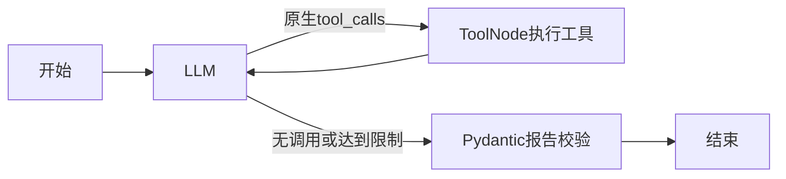

# 当前总体状态：第八阶段真实行情＋真实Agent＋Vue闭环验收通过，达到本地面试演示MVP

更新日期：2026-10-31。Python/FastAPI、LangGraph工具调用和Vue终端均已实现；此前“Agent尚未开发”和“未配置密钥”等语句属于历史记录，不代表当前状态。

- 离线：原有144项Python测试保留通过，第八阶段方向依据修复新增4项，总148项通过；前端新增4项时间/光标读数测试，总7项及Vite生产构建通过。
- 第八阶段真实联合结果：浏览器QQQ日线→4h同会话、黄金日线、QQQ日线+1h均success、source=twelve_data；每周期350根，10个原生调用与执行记录逐一匹配，工具结果回到模型，报告/行情价格、均线、RSI、支撑阻力、时间和快照一致。A/D/B各一次受限报告修复，黄金无需修复。详细结果及真实轨迹见[第八阶段记录](docs/acceptance-phase8.md)。
- 异常展示：单独本地故障页注入504、429与实际StateGraph模型异常路径，均明确提示、保留真实图表，未产生成功报告，恢复后可刷新。仅验证错误处理，不计作真实供应商故障；供应商实际限流/超时/HTTP模型错误本轮未触发，标记SKIPPED。主流程页面始终使用真实服务。
- 图表实际修复：盘中信息从未标注的上海时区/整小时改为统一UTC并保留分钟；光标OHLC与MA图例现在读取同一根后端K线，移出恢复最新，预热缺失不向前取旧值。浏览器已验证，主流程控制台无error/warn。
- 实际修复：新增显式conclusion_basis并校验价格突破或短均线位置/斜率，避免只靠长期均线排列裁决所有方向判断；跨周期结论仍需多个实际interval，单周期长短均线混合不冒充跨周期分歧。安全诊断新增枚举结论和依据，仍不记录模型原文或密钥。
- 浏览器：QQQ/XAU/USD各三个周期、指标/量能/价格线、工具记录、多周期及同会话追问、延迟请求切换、超时/参数/空行情/数据不足/模型失败/连接中断、刷新会话及375/390/430px均已实际验收。复杂场景使用显式确定性脚本，不证明自然语言理解。
- 修复：移动CSS覆盖和画布溢出、缺量/指标预热导致主副图时间错位；增加支撑阻力线、asset_class及数据快照Hash，报告与图表不一致时提示。
- 真实行情（用户提供的运行结果，本轮未重复矩阵）：QQQ与XAU/USD三个周期、AAPL的1h/1day共8项PASSED，均350根、source=twelve_data；AAPL/4h为FAILED(rate_limit)。九项矩阵整体未全通过，不能记为SKIPPED或全部PASSED。
- 第七阶段历史结果：先前401已解除。修复前现场复现A、D均partial：JSON和Pydantic结构有效，但每轮3个证据ID均不匹配真实调用；D还被旧验证器机械集合相等规则误判。修复后正式CLI `--market-source mock --tasks A D`返回Function Calling、multi_turn_natural_language、agent_tasks均PASSED，A/D均success；各一次报告校验即通过，没有使用报告重试。该阶段仅覆盖真实模型＋Mock行情；当前真实联合结果以第八阶段记录为准。
- 报告修复：StateGraph增加受限repair节点，显式提供当前轮证据ID、索引和完整引用token目录；Pydantic校验主周期、引用、数值及方向结论。默认最多一次JSON模式修复，仍失败保留partial/failed/insufficient_data和具体status_reasons；未通过引用验证的解释对象不再返回。报告诊断仅保留结构、可信ID、固定错误和结束原因，不包含原文、提示词或密钥。前端依据主周期选图，无可靠主周期时保留原图。
- 验证器修复：`--deepseek-probe`只做一次最小鉴权请求；`--market-source mock`不再先执行真实行情矩阵；`--tasks A D`支持低成本连续追问；`--skip-market-checks`允许真实联合测试只获取工具所需行情。错误保留HTTP状态码并脱敏，401/402/403/429等终止后续任务。
- 第五阶段的5个提交已正常推送，a83b850的CI已成功。第六阶段独立提交：4ff1372（真实验证），cdbc375（图表/快照修复），da0a5d8（验收测试桩与证据），均已推送且对应CI均为success。文档收尾提交的CI以最新Actions记录为准。
- 当前仍有限制：AAPL/4h此前限流未重测，E等更广任务和长期重复稳定性未验证；精确交易日历/实时开闭市、报价延迟/复权口径未完整验证；内存会话无身份隔离和持久化；缺少部署认证、HTTPS、分布式配额/缓存、监控与恢复方案；模型自由文字校验不是完整语义证明。旧Node仅保留Gemini/旧端点迁移参考，新前端不依赖它。MVP结论限于已实际通过的四条真实本地路径，不代表生产就绪。

完整浏览器记录：[docs/acceptance-phase6.md](docs/acceptance-phase6.md)。安全密钥填写、错误分类与真实测试：[docs/live-api.md](docs/live-api.md)。安装/Mock/真实启动完整命令以README为准。

最新真实闭环验收：[docs/acceptance-phase8.md](docs/acceptance-phase8.md)。[第七阶段](docs/agent-report-phase7.md)和[此前401诊断](docs/real-api-diagnosis.md)保留作历史记录，当前无需继续处理该401。以下历史记录中的SKIPPED仅描述当时运行，不覆盖本轮真实结果。

## 历史阶段档案（保留原记录，以下时态均对应当时）

## 工作区与保护范围
工作目录：E:\ChatGPTFiles\2026-10-29\files-pasted-by-the-user-python\outputs\trading-analysis。
这是上轮从 PinkbeanY1z/trading-analysis 克隆的独立副本，分支 upgrade/python-agent；Git 历史保留，未提交或推送远程。
本轮开始时已有 .gitignore、README、Python 指标/测试、前端 pnpm 锁文件等未提交修改，均保留。搜索 E:\ChatGPTFiles 未找到另一份同项目源码；未检查整个磁盘，不能断言其他目录没有本地修改。本轮未改动其他项目或前端源码。

## 本轮实现
- app/main.py：FastAPI 工厂、生命周期管理、CORS 白名单、统一错误响应和四个 GET 接口。
- app/models.py：配置、请求/响应 Pydantic 模型、symbol/asset/interval 校验。
- app/providers.py：异步 Twelve Data 与显式 Mock Provider、Protocol 扩展接口。
- app/market.py：有界 TTL 缓存、并发请求合并、指标/规则组合。
- 复用 app/services/indicator_service.py，原 14 项测试不变。
- tests/test_api.py：新增 27 项测试；requirements-tested.txt 记录实际验证依赖。
- start-backend.ps1、scripts/smoke_backend.py：启动及真实 HTTP 冒烟验证。

三个业务接口均返回兼容超集：symbol、assetClass、interval、timezone、currency、candles、indicators、rules，以及 source、last_updated、fetched_at、warnings。保留 t/o/h/l/c/v 和原 MA7/25/60 数组。API 文档：/docs。
错误统一为 {error, code}，覆盖422参数错误、404空行情、429限流、503缺密钥、504超时、502上游错误、500内部错误。上游原始错误及密钥不返回客户端。

1h/4h/1day 均直接向 Twelve Data 请求原生周期，prepost=false，不做任何本地固定根数聚合。日线使用交易所日期/时区，盘中请求UTC。4h 的切分由上游原生K线提供，不自建交易所日历；无权限或上游不支持时返回错误，禁止降级成任意4根聚合。
参考：https://twelvedata.com/docs 。
缺失成交量保持null；黄金成交量一律不可用。排序、重复去重、冲突重复拒绝、有限数值和OHLC校验。PDH/PDL取最新分析K线所在交易日期之前的最近日线，不依赖未定义字段。日线获取失败不丢弃盘中结果，而是标记价位不可用。
缓存默认60秒、最大128个品种/周期组合，同一进程并发请求共用；失败不缓存。固定获取350根历史用于预热。超时/网络错误最多尝试两次，429不重试。

## 实际验收
命令（仓库根目录）：
```powershell
& ./.venv/Scripts/python.exe -m pytest -c backend/pyproject.toml -q
& ./.venv/Scripts/python.exe scripts/smoke_backend.py
```
结果：41 passed。第三方 Starlette TestClient 有一条 httpx 弃用警告，无失败。
实际启动 Uvicorn，127.0.0.1:8137 的 /health、/api/market/kline、/api/market/indicators、/api/analysis/rules 全部 HTTP 200；业务请求 QQQ/4h、350根、source=mock；完成后子进程已停止。
真实 Twelve Data：环境变量及本项目 backend/.env 未发现密钥，未发起真实认证请求，不能宣称真实行情验证通过。

## Windows 启动
首次安装（已配置 Python 3.11+）：
```powershell
py -3 -m venv .venv
& ./.venv/Scripts/python.exe -m pip install -r backend/requirements-tested.txt
```
已有本工作区可直接：
```powershell
./start-backend.ps1 -Mock
Invoke-RestMethod http://127.0.0.1:3000/health
Invoke-RestMethod 'http://127.0.0.1:3000/api/market/kline?symbol=XAU%2FUSD&asset=gold&interval=4h'
```
真实模式：仅在 backend/.env 不存在时复制 .env.example，填写 TWELVEDATA_API_KEY，然后执行 ./start-backend.ps1。不需要 LLM Key。配置文件不可提交。

## 限制及下一阶段
- 最新K线可能未完成，目前保留并显式警告，未实现精确交易日历/半日市收盘判定。数据超过四天提示核对休市或延迟，不能据此精确判断交易所停市。
- Mock 使用合成工作日序列，非真实行情且不模拟节假日。
- 缓存为进程内且串行上游获取，不适合作为高并发分布式缓存。
- 规则为确定性均线/偏离/相对成交量/ATR及PDH/PDL规则，未实现原需求全部市场结构检测。
- 本轮仅迁移行情与规则API；未实现 /api/analysis/ai 或 LangGraph。旧前端 refresh 仍等待旧AI接口，因此不能宣称现有整页已完成联调。
- Python 是行情/规则后端的新入口；旧 backend/src 和 package.json 暂保留作迁移参考及旧AI页面回退，后续完成AI接口与前端联动后移除。不要同时占用3000端口。
- 新前端、Agent、真实工具调用、会话管理、报告溯源属于后续工作，本轮未开发。

## 第三阶段：Agent 配置与实现（验证结果见文末）
新增 agents/schemas.py、tools.py、llm.py、graph.py，main.py 注册 POST /api/agent/chat。复用 MarketService 和现有指标，未修改 Provider 或指标算法。每轮使用独立缓存复用计算结果。



StateGraph 使用 InMemorySaver 和 thread_id 保存消息；同一会话串行执行。tools_condition 判断原生调用；官方 ToolNode 逐个执行并记录 call_id、工具名称、参数、结果及成功/失败。每次最多8个工具、最多6轮模型调用（可配）；模型/工具/任务超时独立限制。异常消息经过清理，不返回系统提示词或供应商错误原文。

四个工具：get_market_data（最多20根返回给模型，完整历史用于指标）；calculate_technical_indicators；analyze_market_structure（增加前20根、不含当前的高低点作为阻力支撑）；compare_timeframes（比较确定性趋势）。缺失量能和不足历史不补造。

报告数值由服务器直接复制工具结果，包含call_id、source、last_updated及警告。模型输出受限为结论枚举及证据ID；不接受自由文本数字或任意报告字段。这限制了长篇解释能力，但避免数值幻觉进入报告。状态区分success、partial、failed、insufficient_data。工具失败/无证据不会返回成功报告。

配置：AGENT_MODE=deepseek，DEEPSEEK_API_KEY、DEEPSEEK_BASE_URL、DEEPSEEK_MODEL、DEEPSEEK_TIMEOUT，以及 AGENT_MAX_ROUNDS、AGENT_TIMEOUT、AGENT_TOOL_TIMEOUT。
默认模型采用当前官方示例 deepseek-flash，thinking disabled，ChatOpenAI.bind_tools 发送原生 tools，并回传带tool_call_id的工具消息。不要求OpenAI官方密钥。模型名称可覆盖。
官方依据：https://api-docs.deepseek.com/guides/tool_calls/ ；https://docs.langchain.com/oss/python/langgraph/quickstart 。

Mock LLM 是显式脚本桩：自动化测试通过不同预设AIMessage.tool_calls驱动完整图，不通过用户关键词路由工具。默认Mock演示固定查询QQQ日线，不能当作自然语言自主决策验证。多轮测试证明历史消息送达下一次模型调用；真实代词理解仍需真实模型验证。

```powershell
./start-backend.ps1 -Mock
# 在另一个终端
Invoke-RestMethod -Method Post -Uri http://127.0.0.1:3000/api/agent/chat -ContentType 'application/json' -Body '{"message":"分析 QQQ 的日线趋势和 RSI14。"}'
# 后续请求附带返回的 thread_id
& ./.venv/Scripts/python.exe scripts/smoke_agent.py
# 配置DeepSeek Key后真实验证（行情默认沿用环境配置）：
& ./.venv/Scripts/python.exe scripts/smoke_agent.py --real
```

真实验证脚本在缺Key时明确SKIPPED退出，不伪造成功。也可设置MARKET_PROVIDER=mock，仅验证真实模型工具协议；这种组合不能证明真实行情可用。

开发限制：会话内存保存，重启丢失；最多100会话、单会话消息超过100后拒绝继续；无用户认证和会话所有权隔离，仅限本地开发。整体任务中断将删除该会话checkpoint避免残缺工具消息。未完成Vue对话、实时执行状态和图表联动；旧AI接口仍未迁移，旧Node仅用于回退。未推送远程。

### 第三阶段实际验证结果
- LangGraph 1.2.18 / langchain-openai 1.7.3，已记录完整依赖版本。
- `python -m pytest -c backend/pyproject.toml -q`：60 passed（原有41项 + 新增19项）。
- `python scripts/smoke_agent.py`：实际启动 Uvicorn 8138，POST /api/agent/chat 返回200，status=success，mode=mock；三次工具实际执行成功。
- 轨迹见仓库根目录 agent-trace.json；HTTP日志见 agent-smoke.log。轨迹为明确标注的模拟行情/脚本模型结果，不是真实市场研究。
- 轨迹顺序：LLM → get_market_data (demo_0) → LLM → calculate_technical_indicators (demo_1) → LLM → analyze_market_structure (demo_2) → LLM → validate → END。
- `python scripts/smoke_agent.py --real`：SKIPPED，DEEPSEEK_API_KEY未配置。真实模型协议与自主选择尚未实测，不能宣称通过；官方接口格式已核对并接入。
- 开始测试发现两处测试断言问题已修正：非超时场景不使用10毫秒工具时限；数值幻觉测试比较字段值而不是在浮点序列化文本中搜索数字子串。
- Vue前端未改；后续需新增对话区、会话管理、执行轨迹展示、品种/周期与图表联动。当前API为请求完成后一次返回，不提供实时SSE执行事件。

## 第四阶段实施记录（2026-10-30）
已修改 frontend/src/App.vue、components/KlineChart.vue、vite.config.js；新增 backend/app/agents/report.py、tests/test_report.py；扩展 schemas.py、graph.py。
保留Vue/Vite/Lightweight Charts与深色终端布局。新页面只调用Python API，行情单请求返回K线和指标。支持品种/周期选择、MA20/50/200及旧均线切换、RSI及成交量、PDH/PDL更新、来源/时间/模拟标记。请求序号阻止旧行情覆盖新选择；失败保留旧图并标示标题。
对话通过POST，保留内存thread_id、防重复提交、结果状态及可展开真实工具记录。无SSE或假进度。刷新页面开始新会话。
报告新增 sections:[{title,text}]；确定性模板负责指标与风险文字。模型可提供explanations，并用{{0.rsi}}式引用证据字段；服务器替换可验证引用，删除包含直接数字或无效引用的解释。没有模型解释时仍展示模板。当前自由文本数值过滤较保守，不等于完整语义事实校验；真实模型报告未验证。
图表根据响应symbol/timeframes和证据一致性联动，仅支持当前UI已有QQQ、XAU/USD。比对数据来源和last_updated，不一致时警告。尚未加入数据快照哈希，不能检测相同时间戳K线内容被上游修订的情况。
验证命令：
- .venv/Scripts/python.exe -m pytest -c backend/pyproject.toml -q -p no:cacheprovider：62 passed。
- node frontend/node_modules/vite/bin/vite.js build frontend：成功。未声称执行npm。
- 已实际启动Uvicorn 3000和Vite 5173，浏览器经Vite代理完成行情GET及Agent POST，成功显示报告、调用记录并切回QQQ。
- 浏览器验证QQQ日线、黄金切换/成交量不可用、Mock标识、Agent请求与图表联动。
尚未完整验收：浏览器多周期报告和连续4小时代词理解（默认Mock固定QQQ日线）；网络错误注入/快速切换压力测试；真实DeepSeek/Twelve Data；移动端视觉细节。没有密钥，不能宣称真实自然语言端到端通过。
启动：根目录 ./start-backend.ps1 -Mock；另一终端进入frontend，执行 node node_modules/vite/bin/vite.js --host 127.0.0.1。打开http://127.0.0.1:5173。本轮测试服务仍运行供查看。
本阶段已可浏览器操作，但上述剩余验收尚未完成。未提交或推送远程，未改指标算法与Provider。

## Git交付流程调整（2026-10-30）
今后每阶段测试通过后提交并立即推送upgrade/python-agent，汇报Hash与结果；不自动合并main、不强推。本次将此前累计的相互依赖改造作为一个实际集成快照提交，不虚构四次历史阶段提交。第四阶段未完整验收项继续保留在上述记录。
日志、运行轨迹和一次性work脚本保留本地但加入忽略；修正pnpm配置中的临时占位值。README更新为当前Python/Vue入口，避免历史追加说明误导。

## 第五阶段当前验收（2026-10-30，未全部完成）
- CI：.github/workflows/ci.yml，push upgrade/python-agent / PR main / 手动触发；contents:read；Ubuntu Python3.12，Mock环境；Node24与pnpm11.25.0，frozen-lockfile。YAML解析、本地对应命令通过。缺密钥测试显式选择deepseek模式，避免CI环境变量改变测试语义。
- 新结构规则：两侧各2根严格局部极值（相等不算）；最近两个价格高点/低点与对应RSI比较形成标准背离候选；RSI状态/动量、价格均线位置、前20根支撑阻力、放量突破/缩量反弹/量价不一致。所有结构仍标为provisional，未实现精确收盘确认。
- 自动化：72 passed（0失败），Vite构建成功。新增多周期及连续追问API测试使用脚本LLM驱动完整图，验证thread_id复用与图表行情/指标/时间一致性，不证明模型理解能力。
- 真实验证：scripts/verify_live.py，QQQ/XAU/USD/AAPL×1h/4h/1day，DeepSeek五项任务与连续会话；实际结果Twelve Data=SKIPPED、DeepSeek=SKIPPED，缺项目密钥。真实多轮Function Calling同样SKIPPED。
- 浏览器：本轮实际打开现有Mock页面，QQQ日线正常；快速切换黄金/4h/QQQ/1h后最终主图正确为QQQ/1h。尚未完成全套多周期浏览器、错误注入和移动端验收；不能声称最终验收完成。
- Git：23b5d99 CI；261e1e9结构规则；730cccf真实验证脚本；1a843c8多轮API证据测试。各模块测试后立即提交并尝试推送，但GitHub443连接超时/重置，均未确认推送成功。GitHub连接器查询Actions运行数为0；CI远程结果未验证。
- 旧Node暂保留：Gemini适配与旧AI端点尚未提供完全等价Python替代，新前端不依赖它。不删除独立代理。
- 保留所有本地提交；不强推、不修改main。待网络恢复后正常push开发分支并核实Actions。
