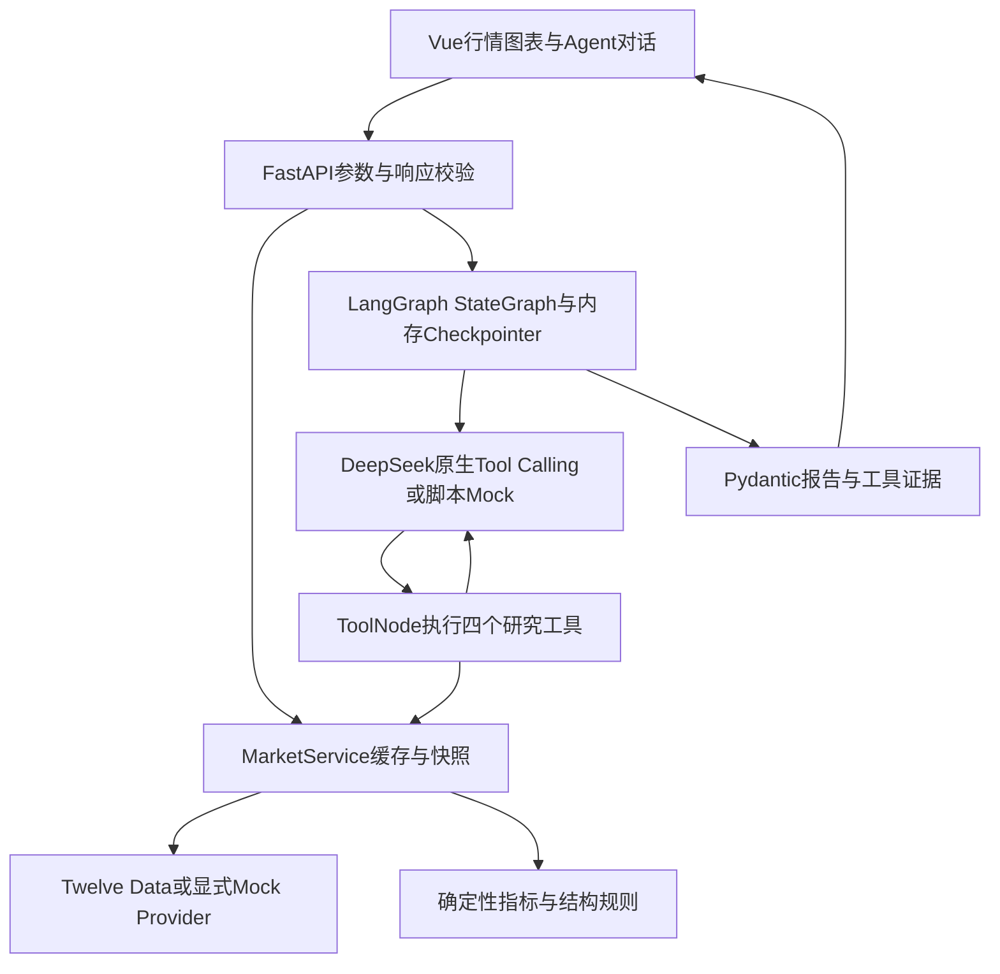

# Trading-Analysis｜行情结构分析智能体

Vue 3 + Vite + Lightweight Charts 行情终端，Python + FastAPI 数据服务，LangGraph 工具调用智能体。模型默认通过兼容接口使用 DeepSeek；行情来自 Twelve Data。仅用于结构与风险研究，不执行交易。

## 当前验收状态

- Python原118项测试保留通过，第七阶段新增26项，总144项通过；前端3项协议测试及Vite构建通过。
- 浏览器已验证QQQ/黄金三个周期、均线/RSI/成交量/价格线、多周期联动、会话复用、错误处理、延迟请求切换和375/390/430px布局。
- 复杂浏览器场景使用明确的确定性测试桩；生产Mock模型仍固定演示QQQ日线，不代表自然语言理解。
- 真实行情：用户此前执行九项矩阵，8项PASSED，AAPL/4h因rate_limit失败，本轮未重跑。真实DeepSeek＋显式Mock行情的QQQ A→D已通过Function Calling、会话追问与报告校验，两轮均status=success；D以4h为主、日线为背景。此结论不覆盖真实行情联合分析和其他任务。证据见 [第七阶段报告验收](docs/agent-report-phase7.md)。
- 实际浏览器证据和复现方法见 [第六阶段验收记录](docs/acceptance-phase6.md)，当前整体状态见 [IMPLEMENTATION_STATUS.md](IMPLEMENTATION_STATUS.md)。

## Windows首次安装

在仓库根目录，使用已验证的Python3.12、Node.js24和pnpm11.25.0：

```powershell
py -3.12 -m venv .venv
& ./.venv/Scripts/python.exe -m pip install -r backend/requirements-tested.txt
cd frontend
pnpm install --frozen-lockfile
cd ..
```

若本机缺少pnpm，可先通过已安装的Node包管理器安装指定版本；不要删除锁文件。若依赖已经安装但pnpm/npm不在PATH，可直接用下述Node命令启动和构建。

## Mock演示启动

终端一（仓库根目录）：

```powershell
./start-backend.ps1 -Mock
```

终端二：

```powershell
cd frontend
pnpm run dev --host 127.0.0.1
# 已安装依赖但没有pnpm命令时：
# node node_modules/vite/bin/vite.js --host 127.0.0.1
```

打开 http://127.0.0.1:5173 ，API文档 http://127.0.0.1:3000/docs 。前端通过Vite代理访问FastAPI；`VITE_API_BASE` 可覆盖浏览器请求地址，进程变量 `VITE_API_TARGET` 可更改Vite代理目标。部署生产静态文件时需配置同源 `/api` 反向代理或设置API地址与CORS。

## 真实模式配置和启动

只在文件不存在时复制，不覆盖已有配置：

```powershell
if (-not (Test-Path -LiteralPath backend/.env)) {
    Copy-Item -LiteralPath backend/.env.example -Destination backend/.env
}
notepad backend/.env
```

在本地编辑器填写 `TWELVEDATA_API_KEY`、`DEEPSEEK_API_KEY`，确认账户支持的 `DEEPSEEK_MODEL` 和 `DEEPSEEK_BASE_URL`。密钥仅后端使用，`.env` 被Git忽略。旧环境变量 `AI_PROVIDER` 不控制新Agent；用 `AGENT_MODE`。进程环境变量优先于文件。

```powershell
# 仓库根目录；与Mock模式二选一，均使用3000端口
./start-backend.ps1
```

前端启动命令相同。模型缺密钥、行情失败、套餐权限不足会明确报错，不伪装成模拟成功。完整安全配置和错误分类见 [真实API指南](docs/live-api.md)。

## 测试和真实验证

```powershell
& ./.venv/Scripts/python.exe -m pytest -c backend/pyproject.toml -q -p no:cacheprovider
node --test frontend/tests/linkage.test.js
node frontend/node_modules/vite/bin/vite.js build frontend
& ./.venv/Scripts/python.exe scripts/smoke_agent.py
# 可选真实请求矩阵，无需先启动Web服务：
& ./.venv/Scripts/python.exe scripts/verify_live.py
# 鉴权故障先只发一次最小DeepSeek请求，不消耗行情额度：
& ./.venv/Scripts/python.exe scripts/verify_live.py --deepseek-probe
# 基础鉴权成功后，真实DeepSeek + Mock行情，仅验证A→D连续追问：
& ./.venv/Scripts/python.exe scripts/verify_live.py --market-source mock --tasks A D
# 上述通过后，再按需验证真实联合流程；不重跑九项行情矩阵：
& ./.venv/Scripts/python.exe scripts/verify_live.py --skip-market-checks --tasks A D
```

读取输出中的PASSED / FAILED / SKIPPED，不以退出码0代替真实验收通过。真实矩阵会消耗行情额度和模型Token。默认GitHub Actions仅执行离线测试与锁文件构建，不使用真实密钥。工作流见 [.github/workflows/ci.yml](.github/workflows/ci.yml)。

## 实际架构



四个工具为行情查询、技术指标、市场结构和多周期比较，复用统一数据服务。数值来自Python工具；报告与图表使用同一数据快照Hash，数据更新或修订会提示重新分析。当前可能未完成的K线保留并警告，结构信号为暂定。

Agent响应新增`primary_timeframe`、`status_reasons`、`report.validation`；主周期必须有本轮已引用证据。默认一次受限报告修复仍失败时保留失败状态。数字和嵌套斜率/偏离率/价格引用只从工具返回的字段映射解析，不执行任意属性访问。

## 边界与旧后端

- 内存会话重启丢失，无身份认证，仅适合本地开发；刷新页面会新建会话。
- 真实行情八项已成功，一项限流；真实模型QQQ日线→4h追问已通过，但更广自然语言任务和真实行情联合流程待验证。精确交易所日历/半日市及实时市场开闭市未验证；历史过期不能解释为当前实时行情。
- 模型解释数字只能引用工具证据，未通过校验的数字被删除，回退为确定性模板。自由文字过滤并不等于完整语义事实校验。
- 旧 `backend/src` 与Node依赖暂作参考：旧Gemini适配和旧AI端点尚未提供完全等价的Python替代。新前端和正式行情/Agent入口均使用Python。独立Gemini代理保留，不作破坏性清理。
- 验收控制接口仅存在于单独启动的 `scripts/browser_fixture.py`，正常FastAPI入口不提供这些接口。

## Git交付

每个独立修复通过相关测试后提交并推送 `upgrade/python-agent`，检查对应CI并汇报Hash与结果。不强推、不自动合并或修改main。生成日志、轨迹、虚拟环境和临时脚本不纳入Git。
