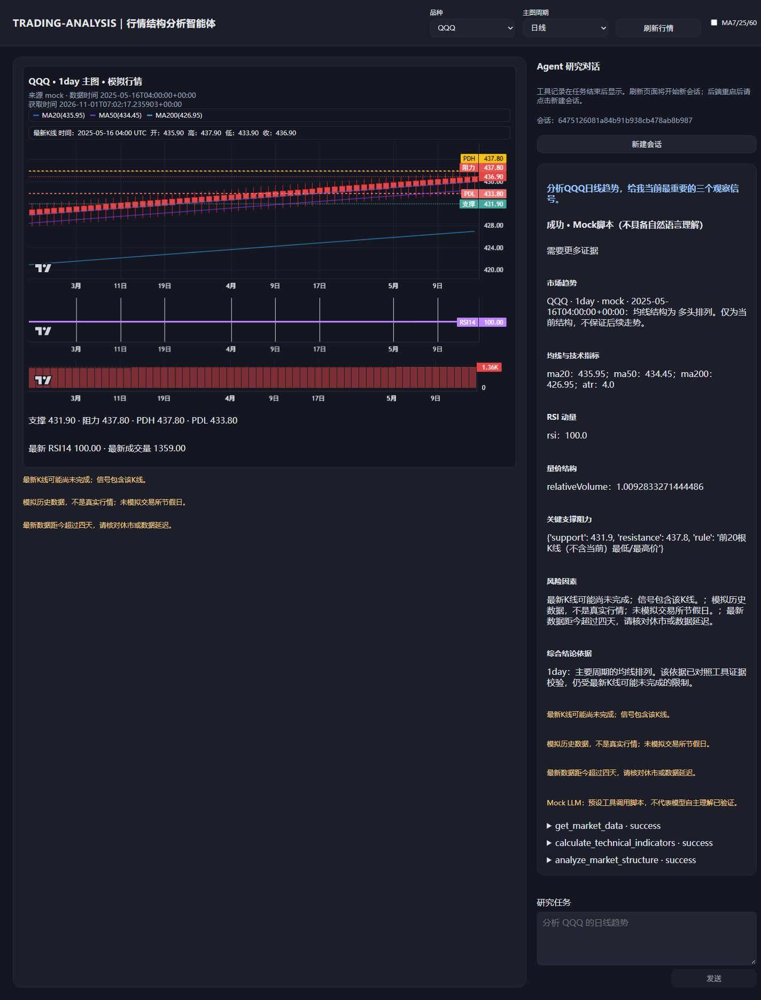
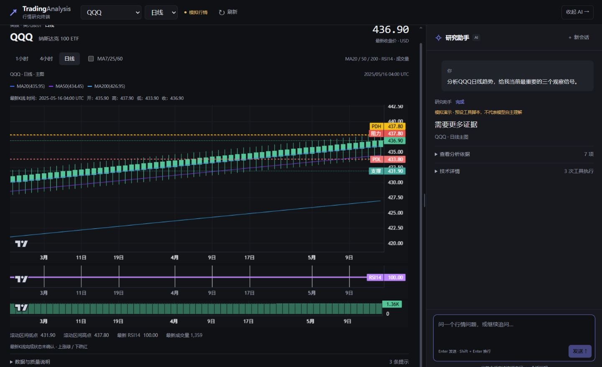

# 9A：设计规范与页面工作区重构

日期：2026-11-01（Asia/Shanghai）。起点：upgrade/python-agent / 284e9c1，工作树干净。使用原工作区，没有重新克隆、切分支或改main。

## 设计研究与实现范围

已阅读[Linear](https://github.com/VoltAgent/awesome-design-md/blob/main/design-md/linear.app/DESIGN.md)、[Binance](https://github.com/VoltAgent/awesome-design-md/blob/main/design-md/binance/DESIGN.md)、[Coinbase](https://github.com/VoltAgent/awesome-design-md/blob/main/design-md/coinbase/DESIGN.md)三份正文。研究记录、颜色/字体/间距/组件/反馈/响应式取舍见[DESIGN.md](../DESIGN.md)。这些文件主要是公开营销页面分析，不是完整官方交易终端规范；项目自行补充分栏、独立滚动、固定输入、键盘与错误状态。

- 深灰表面、单一克制强调色、系统中文字体、等宽数字、紧凑工具栏。统一绿涨红跌并提供文字说明；没有品牌资产、额外字体下载、外部设计仓库运行依赖。
- 桌面占满动态视口，图表/对话独立滚动。420px默认助手宽度，指针拖动、方向键/Home/End、双击复位；收起助手不销毁消息，Lightweight Charts自动响应宽度。
- 对话中间滚动，底部输入区固定。Enter发送、Shift+Enter换行、中文组合输入保护；真实等待状态、防重复提交、同一thread_id、阅读旧消息时保留滚动位置与“查看最新”。
- 移动端行情/分析Tab保留状态，触控44px、输入16px、安全区内边距；不把两栏压成整页长列表。
- 旧报告结论先行，完整旧章节折叠到依据，真实执行记录与证据目录折叠到技术详情；不默认显示JSON。内部错误码外层显示中文，原码在技术详情保留。报告快照不一致依然外显告警。
- 比较图只在可靠多周期响应后提供，默认折叠。图表数值始终来自后端，未新增MA/RSI算法或修改Provider、Agent图、Pydantic校验。
- 价位命名为滚动区间极值；时间简化为日期/分钟UTC，完整来源/时间/快照仍可查看。最新K线完成状态未确认。

## 自动化验证

从仓库根目录实际执行：

```powershell
& ./.venv/Scripts/python.exe -m pytest -c backend/pyproject.toml -q -p no:cacheprovider
node --test frontend/tests/*.test.js
node frontend/node_modules/vite/bin/vite.js build frontend
```

结果：Python **148 passed in 8.35s**，前端 **19/19**，Vite **构建成功**。保留前端原7项，新增12项：数字/缺值、UTC/显式时区与非法日期、工具/来源标签、中文错误解释、分栏边界/键盘、IME与换行保护。未声称执行npm，使用本地已安装Node与Vite。

## 实际浏览器验证

使用真实Vue、Lightweight Charts和FastAPI。交互测试后端为仓库现有 `scripts/browser_fixture.py`，明确Mock Provider + ScriptedLLM，通过StateGraph返回响应；不是自然语言理解测试。真实行情页另用正常 `app.main:app`，没有测试控制路由、Mock回退或模型替代。

| 项目 | 实际观察 | 结果 |
| --- | --- | --- |
| 1440×900长报告 | 改造前整页1870px，输入区top约1676px；改造后整页900px，输入区754–866px；展开932px依据只让620px消息区域滚动 | PASSED |
| 调整/收起 | 键盘420→444px，实际指针拖动444→532px，双击复位420px；收起图表宽约1382px、图表原生表格约1380px；再展开保留消息 | PASSED |
| 移动375/390/430×812 | 行情/分析各自可操作，页面宽等于视口；图表表格332/348/388px；已有消息保留，输入底部约780px，未超出812px视口 | PASSED |
| 会话与多周期 | 显式followup脚本的第二次请求沿用thread_id；主图4h。multi脚本展示日线主图，1h比较图默认折叠、展开后正确测量宽度 | PASSED（协议） |
| 模型失败 | 显式本地异常通过实际Agent错误路径返回failed；显示“模型服务请求失败，本次研究未完成”，保留已有图表与可编辑输入 | PASSED（受控故障） |
| 旧请求竞态、非法行情参数 | QQQ日线请求延迟期间切黄金，旧请求完成后仍显示XAU/USD；随后注入422，明确提示“验收测试桩：请求参数无效”，已有黄金画布/标题均保留 | PASSED（受控故障） |
| 正常页控制台 | 移动测试页正常操作error/warn为空；预期HTTP错误另行识别，不能称供应商故障通过 | PASSED |
| 真实QQQ日线展示 | twelve_data，收盘690.49，MA20/50/200显示728.19/725.00/679.52，RSI34.88，时间2026/10/30 04:00 UTC | PASSED（行情展示） |
| 真实黄金日线展示 | twelve_data，收盘3,875.44、RSI28.21，明确“成交量不可用”，上游日期2026/11/01 00:00 UTC，未判市场开市 | PASSED（行情展示） |
| 真实DeepSeek回答质量/真实A–D | 9A未改报告协议，未重新调用真实模型验收，不能沿用Mock脚本结果冒充真实理解 | NOT_RUN，留待9B/9C |

真实行情页起初受执行环境外部连接限制，出现明确“行情服务连接失败”，没有切到Mock；允许外部连接后同一QQQ日线请求正常，随后仅检查黄金日线。未执行九项矩阵。黄金周末K线的来源服务/报价口径、时区和完整交易时段仍须9C核查；“供应商返回K线”不等于“市场正常可交易”。

## 前后截图

以下为真实浏览器截图，无后期拼贴。前后同题对比使用同一明确离线测试桩，证明布局，不证明回答质量。

| 改造前：输入框随报告下移 | 改造后：图表和消息独立滚动 |
| --- | --- |
|  |  |

[展开长依据仍保留输入](screenshots/phase9a/after-desktop-expanded.png) · [375行情](screenshots/phase9a/after-mobile-375-market.png) · [375分析](screenshots/phase9a/after-mobile-375-analysis.png) · [390分析](screenshots/phase9a/after-mobile-390-analysis.png) · [430分析](screenshots/phase9a/after-mobile-430-analysis.png) · [受控模型故障](screenshots/phase9a/controlled-model-error.png)。

真实行情单独记录：[QQQ桌面](screenshots/phase9a/after-real-desktop.png) · [QQQ375px](screenshots/phase9a/after-real-mobile-375.png) · [黄金375px](screenshots/phase9a/after-real-gold-mobile.png)。这些截图没有声称重新完成真实模型研究。

## 重现

```powershell
# 离线布局验收：终端一
& ./.venv/Scripts/python.exe -m uvicorn browser_fixture:app --app-dir scripts --host 127.0.0.1 --port 8190 --no-access-log
# 终端二
$env:VITE_API_TARGET='http://127.0.0.1:8190'
node frontend/node_modules/vite/bin/vite.js frontend --host 127.0.0.1 --port 5190 --strictPort
# 单独终端显式选择多周期脚本；不按用户关键词伪装自主理解
Invoke-RestMethod -Method Post -Uri http://127.0.0.1:8190/__test/scenario -ContentType application/json -Body '{"scenario":"multi"}'
```

真实模式使用README正常启动命令或本轮8191/5191端口，沿用现有backend/.env；密钥仅后端读取、不输出。不把测试桩控制路由部署到真实服务。

## 尚未完成

9B：问题优先意图与answer_blocks、自然解释/数值验证、可编辑盈亏比/成本与胜率“未验证”。旧章节展开后仍可能出现原字段、字典及长小数，9A没有以隐藏内容代替报告机制修复。

9C：指标显隐、价格标签避让与语义、十字光标联动、报告价位与同快照图表定位、黄金报价口径/时段核查、真实用户A–D及完整端到端验收。9A也未测试真实手机软键盘/触摸设备，已覆盖浏览器375/390/430视口。

9A完成后独立Commit并正常Push至upgrade/python-agent，再核实对应Actions后端/前端任务。具体Hash与CI运行链接在交付报告，main不变，不强推，不提交密钥、测试日志或临时文件。
