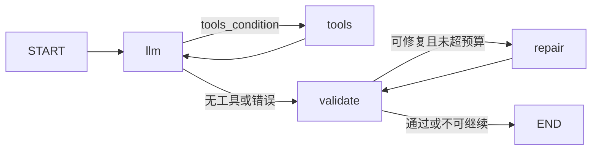

# 第七阶段：真实DeepSeek报告与连续追问验收

本轮在现有`upgrade/python-agent`工作区修复报告协议与验收标准，没有重新执行第六阶段浏览器验收，没有请求Twelve Data。行情显式为Mock，模型为项目配置的真实DeepSeek。

## 原因与修复

修复前现场复现与用户结果一致：Function Calling通过，A/D均partial。两轮最终内容都是JSON对象，字段通过Pydantic验证；但每轮3个evidence_ids都不是本轮真实工具调用ID。旧代码只发通用invalid_report，还在引用验证抛错后保留已赋值的interpretation，无法清楚区分字段错误与引用错误。

现在每次模型调用都提供本轮真实工具ID、证据索引和可用字段完整token目录。Interpretation增加必填primary_timeframe；证据、主周期、结论、数值引用全部通过后才用于报告。未通过校验的解释对象为None，不渲染未验证解释。

旧D验证器要求证据周期集合完全等于{4h}，把合理日线背景也当作wrong_timeframes。这属于验收标准问题；旧响应没有独立主周期字段，单靠集合也无法证明主次。新标准要求QQQ、主要周期4h和被引用的本轮4h证据，允许1day背景；额外1h、错误主周期、品种、来源和篡改数值仍不能通过。前端依据明确主周期选图；新响应主周期缺失时保留原图。

开发中还保留了未通过的真实复测：引用ID修正后出现数字解释/引用错误；平坦字段协议不能表达嵌套斜率/偏离率/支撑阻力；数字过滤把周期及均线标签当成读数。现在使用工具实际标量字段的封闭映射，完整token逐字引用，允许明确的技术标签但继续拒绝直接价格、阈值、未知字段及未引用证据。没有把失败运行改写为成功。

较长解释也曾出现JSON/引用失败；当时未记录finish_reason，不能断言是截断。新协议要求简短解释，完整数值由确定性模板展示，并加入结束原因诊断。默认最多一次JSON模式受限修复；它不重新调用工具，也不会强制success。最终通过的运行没有使用修复调用。

## 执行图与诊断



`report.validation.attempts`仅保留JSON类型、允许字段的类型、可信引用ID、未知ID计数、固定错误路径、数值引用检查、finish_reason。没有原始报告、任意额外字段内容、系统提示词、密钥或请求头。`status_reasons`分别标识missing_report、missing/invalid_conclusion、invalid_json、schema_validation、unknown_evidence_ids、primary_timeframe_not_cited、unverified_numeric_prose、insufficient_history、tool_execution_failed等。仍使用兼容的四种顶层状态，不能用partial掩盖具体原因。

## 最终正式CLI真实结果

```powershell
& ./.venv/Scripts/python.exe scripts/verify_live.py --market-source mock --tasks A D
```

退出码0。deepseek_function_calling=PASSED、multi_turn_natural_language=PASSED、agent_tasks=PASSED、twelve_data=NOT_RUN。

| 项目 | A | D |
| --- | --- | --- |
| symbol | QQQ | QQQ |
| primary_timeframe | 1day | 4h |
| timeframes | [1day] | [4h,1day] |
| status | success | success |
| data_sources | [mock] | [mock] |
| user_message_count | 1 | 2，同thread_id检查通过 |
| 模型调用 | 工具选择→工具结果返回→最终JSON，共2次 | 同左，共2次 |
| 工具记录 | 3次成功 | 3次成功 |
| 报告校验 | 一次通过，未知ID=0、issues=[] | 一次通过，未知ID=0、issues=[] |
| checks_failed/model_errors | [] / [] | [] / [] |
| finish_reason | tool_calls→stop | tool_calls→stop |

实际工具轨迹，所有native tool_calls与执行记录逐一匹配，结果进入下一次真实模型请求：

| 任务 | call_id | 工具 | 执行 |
| --- | --- | --- | --- |
| A | call_00_Y8yeaaFZNfLpuIAnilrK2370 | calculate_technical_indicators | success |
| A | call_01_3yfzeC4XcybJeYHTQyzc7904 | analyze_market_structure | success |
| A | call_02_A2SU5MoyfdVfp6Dj6KWc4475 | get_market_data | success |
| D | call_00_KvReftQAsZ5EZXWxNonG7189 | calculate_technical_indicators | success |
| D | call_01_lpoHWZMjf5BZGd8SnXRW3225 | analyze_market_structure | success |
| D | call_02_GYIzGlYMMqTohhxQHJfW8759 | compare_timeframes | success |

脱敏的本地详细结果保存在忽略目录`work/stage7-final-cli.json`，不纳入Git。此前失败记录也保留在work目录，不提交日志。没有使用脚本Mock LLM替代真实模型，也没有把Mock行情描述为真实市场。

## 工程验证与边界

新增26项Python测试（22项报告图测试、4项验收回归），全部通过真实StateGraph执行；原118项保留，总144项通过。前端新增1项主周期协议测试，总3项通过；Vite生产构建通过。

```powershell
& ./.venv/Scripts/python.exe -m pytest -c backend/pyproject.toml -q -p no:cacheprovider
node --test frontend/tests/linkage.test.js
node frontend/node_modules/vite/bin/vite.js build frontend
```

本次真实自然语言验收只覆盖QQQ日线→同会话4h追问；B/C/E、真实行情＋模型联合流程未重测，不据此宣称所有任务都能稳定成功。此前Twelve Data八项成功、一项AAPL/4h限流的记录继续保留。本轮未修改.env、密钥、远程地址或main；自由文字过滤不等于完整语义事实证明。
